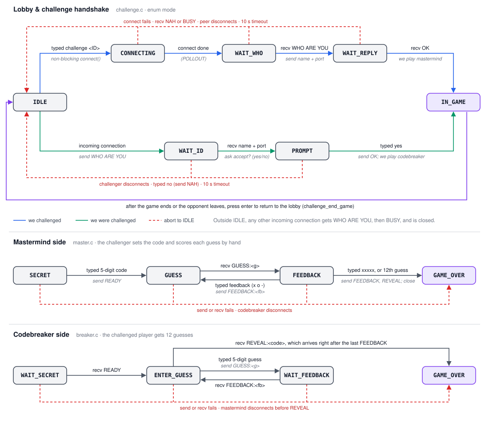

<h1 align="center">mastermind</h1>

<p align="center">Two-player Mastermind in your terminal, played over a LAN.</p>

---

mastermind is a program for playing [Mastermind](https://en.wikipedia.org/wiki/Mastermind_(board_game)) against someone else on
your network. Start it on two machines and they find each other on their own.

```
Players Online:
ID   Name            IP Addr         Port    Last Seen
1    bob             10.94.78.196    7001    1 s. ago
2    carol           10.94.78.12     7000    0 s. ago
3    dave            10.94.78.203    7000    2 s. ago
4    erin            10.94.78.57     7000    1 s. ago
5    erin2           10.94.78.57     7001    3 s. ago

________________________________________________________

> challenge 2
```


## Gameplay

```
mastermind [--log]
```

- `--log`: log every message sent and received to `log.txt`.

Pick a name, then challenge someone from the lobby with `challenge <ID>`. If
they accept, you set a secret 5-digit code and they get 12 guesses to find it.
You score each guess yourself: `x` for right digit in the right place, `o` for
right digit in the wrong place, `-` for not in the code.

```
12345  oooo-
41203  xoxox
40231  xxxoo
40213  xxxxx
*****  *****
...
-----
40213

>
game over. press enter to go home
```

## Building

You need GCC 14+ (for C23) on Linux.

```sh
make          # builds ./mastermind
make clean    # removes it
```


## Implementation



Players find each other by broadcasting a UDP packet every 2 seconds on port
9555:

```
+-------+------------+-------------------------+------------------+
| LIES  | session id |          name           |       port       |
|  4 B  |  2 B (BE)  | 16 B, PKCS#7 padded     | ASCII digits     |
+-------+------------+-------------------------+------------------+
```

The challenge and the game itself go over TCP. Messages end with `\r\n\r\n`:

```
B -> A   WHO ARE YOU
A -> B   <name>\r\n<port>
B -> A   OK | NAH | BUSY

A -> B   READY
B -> A   GUESS:<guess>
A -> B   FEEDBACK:<feedback>
...
A -> B   REVEAL:<code>
```


## Exit codes

| Code | Meaning |
| ---- | ------- |
| 1 | General error |
| 2 | Network error |


## License

This program is licensed under the [MIT License](LICENSE).

## Contributions

Contributions are welcome. Please submit a PR or issue on Github.

## AI usage

AI was only used to generate the implementation diagram.
